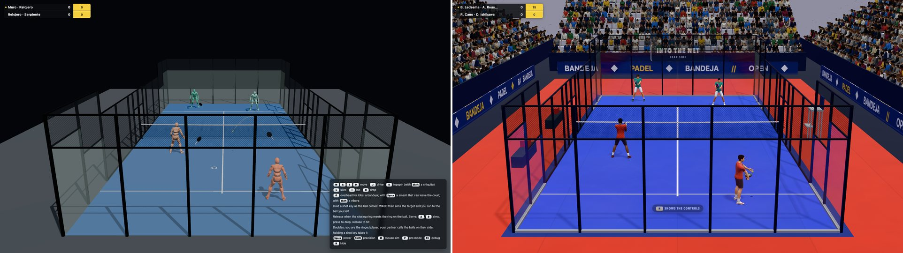
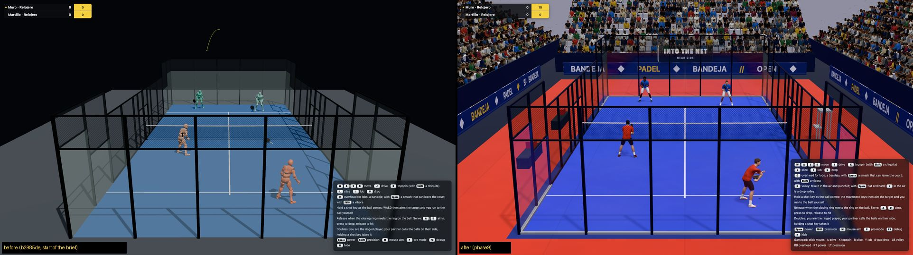
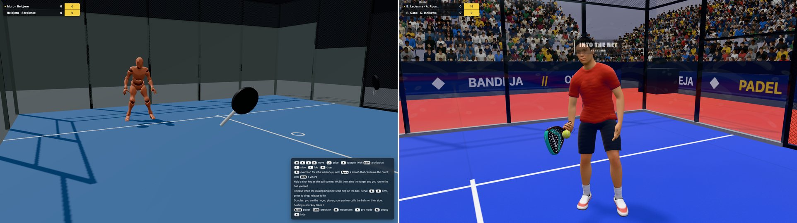
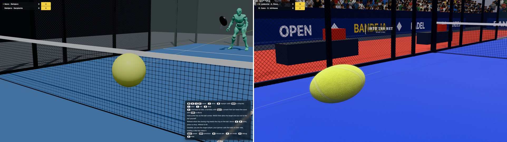
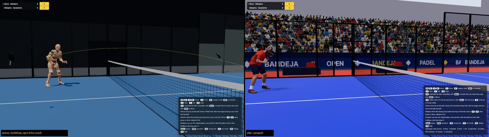
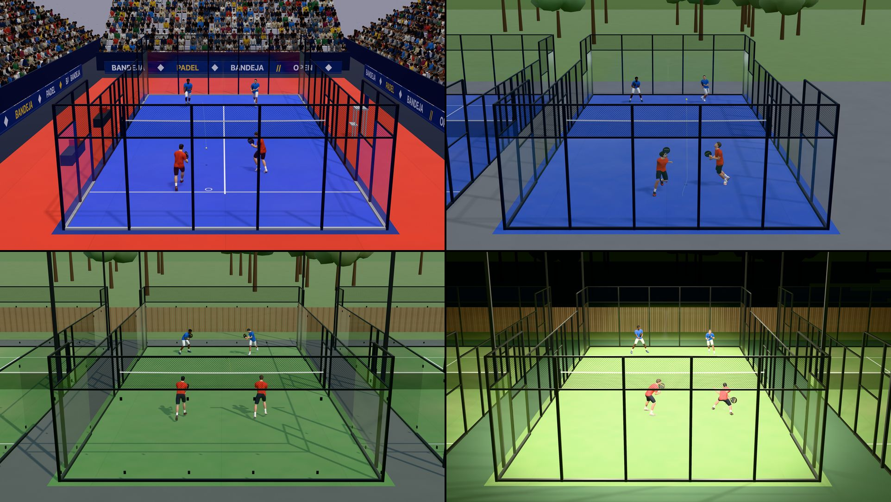

# BANDEJA realism brief: summary

The owner's brief (27 Oct 2026): make the game as realistic and as good as possible, in nine phases, each verified
before the next. It also asked for a volley shot, a serve more like the pros' and a better-looking court, and
during the work: real net physics, play off the back glass, padel rackets and their grip, the ball's look and real
people. This page covers what each phase changed, the numbers before and after, and the bugs found and fixed. The
reasons and the evidence are in `DECISIONS.md`, phase by phase. What couldn't be verified here is in
`OPEN_QUESTIONS.md`.

- Machine for every number: this M1 Max, Chrome, 1080p, unless a line says otherwise. Other sessions' Chromes and
  system daemons often loaded the machine, so frame rates from Phase 8 on come from paired runs back to back, with
  the load average printed.
- "AI doubles" means four AI players at level 1, headless, measured the way pro match-analysis studies measure
  (`tools/match-stats.ts`, `tools/point-mix.ts`).
- Every phase ended with an independent verifier and a fresh-eyes reviewer (read-only agents), repeated until a
  fresh review found nothing new and serious.

## Before and after
The build at the start of the brief (b2985de) against this one, at the same seed and moment of an AI match. The
close-ups use a camera placed from the sim's own positions, so both builds get the same view
(`tools/before-after.mjs`).

The broadcast view:

A player: the Y Bot mannequin with a stick racket, against a MakeHuman player holding a padel racket in a
continental grip.

The ball in flight: one flat yellow before, felt and seam with the shutter's stretch after.

The net and the court:

The four arenas now (stadium, covered club hall, outdoor club by day and under floodlights), none of which existed
before the brief:

## Phase 1: ball physics validation
**What changed**
- A ball lab (`node tools/ball-lab.ts`, `?lab=ball`) fires 38 shots at the floor, the glass, the mesh, the corners
  and the joins. It measures every contact (restitution, spin, scatter, energy) and locks the tuned numbers into
  tests.
- The bounce is tuned to published data:
  - Restitution falls with impact speed at a tennis ball's measured rate (Dignall).
  - Turf bounces like a hard floor less the sand, and its friction (0.59) is inside IBV's padel-ball range.
  - Glass is rigid × 0.985 with friction 0.35 (ITF felt on glazed tile). Flush glass joins are no longer frames.
  - Wear follows IBV/Testfakta's 666-stroke test. Clay friction is Cross's 0.70.
- Junctions (a ball meeting the floor and the glass within one contact time) are solved as one squeeze, not as two
  instant bounces in an order a millimetre decided.

**Numbers**

| | Before | After |
|---|---|---|
| FIP drop test (2.54 m onto the hard floor) | 141 cm | 141 cm (135-145 allowed) |
| Lab court pace on turf (IBV: 36-50) | not measured | CPR 44.7 |
| Scatter off a back-glass seam | 20.9 ± 15.8° | 2.5 ± 1.9° |
| Topspin drive off the back glass, distance back | 11.4 m | 11.6 m |
| Corner fuzz (100k balls): tunnels through the glass, balls left inside a wall | 38, 31 | 0, 0 |
| Medium, CPU 4×: frame p50 / p99 | 2.4 / 4.5 ms | 2.4 / 4.3 ms |
| High, 2× pixel ratio | 498 fps | 539 fps (±8% between runs of one build) |

**Bugs found and fixed** (five review rounds)
- A ball landing at the foot of the glass went 4.1 m up or 1.1 m up depending on a 4 mm shift (junction order).
- The sand randomised bounce height by 26%; it now skews the line, not the height.
- A kiss of the glass halved the floor bounce.
- Corner balls tunnelled through the third wall.
- A topspin nick at the glass foot lost the point.
- Rolling balls went through walls.
- A ball pushed onto the rigid net's plane hung in the air.
- Two V8 traps made the ball step allocate: the wear update's `exp()` blew the inlining budget, and the `exp`
  wrapper boxed doubles. Both were fixed, bringing it back to 3-8 GCs per 100k ticks against a budget of 10.

## Phase 2: game feel
**What changed**
- **Input latency.** The render draws the present instead of one tick behind (run-ahead). While a swing is held, the
  sim is not run ahead, so no strike lands late.
- **The volley** gets its own key (N), as the owner asked. It plans the ball in the air with a reach band, met on the
  move.
- **Timing windows per shot**, from how fast each shot's face turns: a punch volley 1.35×, a lob 1.19×, a bandeja
  0.84×, a víbora 0.76×, a smash 0.71×.
- **A real split-step.** The hop is airborne about 142 ms, and force builds from 20% at a standstill. A target 1-2.5 m
  away is reached 11-16% sooner (measured: 104 ms, 13.1%).
- **Hit feedback.** Racket sounds by contact quality, a camera kick on smashes, and gamepad support with rumble.
- Every feel value is listed in `FEEL.md`.

**Numbers**

| | Before | After |
|---|---|---|
| Key → frame drawn, p50 / p95 (`tools/latency.mjs`) | 9.1 / 11.4 ms | 5.0 / 8.7 ms |
| Key → GPU done, p50 / p95 | 14.2 / 17.3 ms | 10.6 / 14.3 ms |
| Late strikes while a swing is held, 60-240 Hz emulation | 6-34% of releases | 0 |
| Doubles net player taking the ball in the air | 36% (drive key) | 80% (volley key) |
| Medium 4× frame p99 | 4.3 ms | 4.1 ms |

**Bugs found and fixed** (verifier, then four fresh-eyes rounds)
- Run-ahead struck the ball up to a tick late (11-30% of releases).
- The HUD's calls changed the sim, so the same seed played out differently with `?autotime=1`.
- A held swing was drawn unblended at 120 Hz and faster screens: frames repeated, then jumped.
- A modifier let go 0-6 ms after the shot key was lost, turning every smash into a bandeja.
- The AI held power or precision for the whole match after its first smash or víbora, so its styles made no
  difference.
- The timing ring counted down on the drawn clock (+20 ms at 60 Hz).
- After a hitch, queued keys were graded up to 220 ms early.

## Phase 3: animation realism
**What changed**
- **Measured first.** An animation QA (`tools/anim-check.ts`) draws every tick of a match and measures:
  - foot skating, soles under the floor and joint speeds against what people reach;
  - racket to ball at contact;
  - one-frame pops and clipping against capsules fitted to the mesh.
  It runs as a test (`tests/render/animQa.test.ts`).
- **Smoother motion.** The animation's inputs are inertialized (Bollo, Holden), never the IK's output.
- **Feet.** Planted feet stay where they were put down, and diagonal running uses orientation warping.
- **Limbs.** Arms are solved as hinges measured from the clips.
- **Legs.** Rate limits on the hips, knees, shins and lunges, each traced frame by frame.
- **Contact in front of the body, as pros play it.** Ground strokes are planned 0.6 m in front (it was 0.12 m),
  against highly trained players' 0.64 m (Sánchez-Alcaraz 2021).
- **Low balls are a lunge, not a squat.**
- **The serve, from pro studies** (the owner's ask):
  - The player stands side-on, and the ball is pushed down from 0.95 m so it bounces to the waist.
  - The backswing is turned 100° (research: 105°), with contact out to the side.
  - Contact height went from 0.57 m to 0.87 m.
- Motion matching was not built, because six looping Mixamo clips give it nothing to match (`OPEN_QUESTIONS.md`).

**Numbers** (3 seeds × 120 s, AI doubles)

| | Before | After |
|---|---|---|
| Foot skating | 54-68 cm/s | 16-18 cm/s |
| Soles under the floor | 7-9% of foot frames (8 cm) | 0 |
| One-frame pops | 118-145 per player-minute | 14.8-18.3 |
| Worst one-frame joint turn | 177° | 96° |
| Racket inside the body | 2.0-2.6% of frames | 0.15-0.19% |
| Racket to ball at contact, p50 / p90 | not measured | 4-8 mm / 7.8-8.3 cm |
| Serve contact height | 0.57 m | 0.87 m |

**Bugs found and fixed** (a verifier and three fresh reviews)
- Forearms flipped 150-180° in a frame: two-bone IK turned the wrong way.
- Racket blends re-picked the short way mid-blend.
- Left-handers' feet flipped.
- The same moment drawn twice snapped every body.
- Knees spun 150-165° over a tenth of a second, which the pop rule couldn't see. This is now its own QA measure.
- The hips lurched up to 29 cm in a frame, then fell 20-30 cm after a fix.
- Feet tapped.

## Phase 4: AI
**What changed**
- **Measured first.** `node tools/match-stats.ts` plays AI doubles headless and measures them the way match-analysis
  studies measure pro padel: shots and seconds a point, endings, the shot mix, per-stroke outcomes and the serve.
  Forced errors are judged by `src/sim/ai/pressure.ts`, which was written before any tuning and never changed by it.
- **Human limits:**
  - Reaction is 0.30 − 0.13 × level s, so 0.17 s at the top (pros commit at 140-160 ms; Triolet 2013, Mecheri 2019).
  - A correction delay after surprising bounces.
  - No smashing a ball still climbing past the shoulders off the glass.
  - No strokes at a ball behind the body, and no swings at the air.
- **Overheads at their own heights:** bandeja 1.95 m, víbora 1.72 m, smash 2.42 m. All of them used to be planned at
  2.35 m. The smash is hit in the air with a jump.
- **Doubles teamwork:**
  - Partners switch sides when one takes the other's lob (0 of 29 before, 68-74% after).
  - They cross back and call "Mine!", "Yours!" and "Switch!".
- **Difficulty** is fitted to the published ladder: novices about 5.6 shots a point, recreational players 7.3,
  national 8.0, pros 10-11.
- **Four personalities you can tell apart:**
  - Martillo drives 27% of its shots and smashes 71% of its overheads.
  - El Muro lobs 28%.
  - La Serpiente plays 68% of its overheads as víboras.

**Numbers** (AI doubles at the top level)

| | Before | Pros | After |
|---|---|---|---|
| Shots a point | 16.2-16.5 | 10-11 | 10.9 |
| Seconds a point | 21.6-22.0 | 13.5-14.8 | 14.9 |
| Winners / forced / unforced errors | 27 / 35 / 37% | 34-42 / 29-33 / 29-33% | 42.5 / 22.9 / 34.6% |
| Points ending on a swing at the air | 35% | 0 | 10.3% (balls that died below reach) |
| Level 0 shots a point, first-serve faults | 2.5, 55% | about 5.6 | 5.2, 14% |

**Bugs found and fixed**
- AI modifiers stayed held all match (from Phase 2).
- Partners switched lanes off a stale plan (94 episodes in 4 × 300 s, now 10).
- Blocks were "corrected" for nothing (27 of 153 corrections).
- A beaten AI swung at the air: stand-downs swung 90-100% of the way; now 17 of 19 make no forward swing.
- Good volleys 70 ms late were cut.
- The switch call didn't follow the formation's own rule, and cross-backs twitched (7 of 13).

## Phase 5: visual realism (photo-match)
**What changed**
- **Photo-match mode** (`?photo=<id>`). Eleven public reference photos of real courts are used:
  - The camera is solved from hand-marked court points (2.4 px RMS on arena-wide-2).
  - The game renders through that camera with the photo over it as a wipe, a blend or lines.
- **Four arenas** (stadium, covered club hall, outdoor club by day and by night). Colours were picked off the
  photos, and the boards are generic, with no real event's branding.
- **Turf.** Sand-filled fibres at two scales, wear where players stand, roll seams 4 m apart, and lines painted in
  the shader.
- **Glass.** Fresnel reflection of a box-projected environment, a faint iron green, ball prints and dust at the
  foot.
- **Players dressed.** Kit regions in the shader, sweat that grows with the match, folds, and hems that lag the
  body.
- **Ball.** Optic-yellow felt with sheen and fuzz, and the seam turned by the sim's spin.
- **Broadcast camera at the TV position** (7.6 m up, 15.5 m back, a 26° lens; Javadiha 2021). Before, it was 6.3 m up,
  9.2 m back with a 42° lens.
- **Look.** Khronos PBR Neutral tone mapping and HDR bloom.
- **Optional TV graphics** behind `?gfx=tv`: a score bug, point straps, radar speeds and match stats.

**Numbers**

| | Before | After |
|---|---|---|
| Draw calls, triangles | 43, 473k | 78, 848k |
| Medium 4× frame p50 / p99 | 2.5 / 4.3 ms | 5.5 / 8.4 ms (178 fps, 0 frames over 20 ms) |
| High 2× p99, frames over 20 ms | 8.8 ms, 0.66% | 22.7 ms, 1.95% (Phase 8 work) |
| Night turf colour against the night photo (sRGB) | not matched | 180-191 / 207-234 / 135-139 against 169-195 / 187-217 / 117-128 |

**Bugs found and fixed**
- The 26° lens made the approved timing rings 1.7× bigger on screen; they're now scaled by the lens.
- Lobs left the top of the frame (38 of 154 rallies). The camera now tilts with the ball.
- The crowd cost 891k triangles. It was cut to 302k drawn, then replaced in Phase 9.
- `bumpMap()` did nothing on procedural heights, so the folds and fuzz were invisible. Bump is now differentiated
  in screen space.
- The kit's regions blended through other regions' colours: dark sock rings and black seams.
- A double fault never got its TV strap.

## Phase 6: sound
**What changed**
- No recordings were available, so every sound is synthesised from physical models and measured in tests:
  - **Racket:** a perforated paddle "pock" at 450-1500 Hz (Piana 2025), and a frame clack above 2 kHz.
  - **Bounce:** on hard, 1 kHz then a decaying 250 Hz.
  - **Glass:** a panel's plate modes from 10.7 Hz up.
  - **Mesh and posts:** mesh wire modes and rattle, posts ringing as free bars.
  - **Net:** a catch "fwump".
  - **Shoes:** crunch on turf, squeak on hard.
  - **Swish:** rises with racket speed.
  - **Grunts:** formant voices (Klatt).
  - **Crowd:** applause from ClaPD clappers and gasps, groans and cheers.
  - **Rooms:** an impulse response per arena (stadium RT60 2.4 / 2.0 / 1.3 s).
  - **Ambience:** birds, crickets, floodlight hum and next-door courts.
- Sounds play at the event's exact time, from the broadcast camera.
- The crowd follows the match: hushed for the serve, a murmur of tension, applause by the point.

**Numbers**: medium 4× with sound on against off: 141 against 178 fps (about 0.35-0.4 ms a frame unthrottled), and
still 0 frames over 20 ms.

**Bugs found and fixed**
- **Critical:** sound froze for good in Firefox, because `AudioListener.positionX` doesn't exist there.
- **High:**
  - A club's eight watchers clapped as loud as a stadium.
  - The master compressor coloured every mix.
  - The racket's sound came from the timing grade instead of the impact, so a Perfect frame shot sounded clean.
  - Scuffs depended on the frame rate.
- **Medium:** levels stepped between bins, every floor was equally loud, the crowd carried its state between points,
  and two-render sounds alternated A/B/A/B.

## Phase 7: rules and QA
**What changed**
- **Oracles.** A referee and a scorer written from the FIP text alone, without reading the game's rules code, judge
  every call. Where the text is ambiguous, `tools/qa/ORACLE-NOTES.md` holds 44 readings. When the game and an oracle
  disagree, the FIP text decides.
- **The QA army** (`tools/qa/army.ts`):
  - It draws thousands of matches across every mode, court, floor, ball, climate, scoring format, level, style and
    handedness.
  - Three kinds of player take part: the AI, "bots" (the human code path played well) and "monkeys" (random keys).
  - Every tick is checked: walls, the floor, the net, tunnelling, speed, spin, energy, stuck balls, players, NaN,
    slow ticks and the heap.
- **An animation army and a 20-minute browser soak.**

**Numbers**

| Run | Result |
|---|---|
| First army run (200 matches) | 86 corner calls and 6 net-touch disagreements |
| `p7-r1` (2,000 matches, 549 h of play) | 39 matches with a problem |
| `p7-r3` (2,000 new matches) | 5, of which 4 were the checker's own mistakes |
| Animation army, 60 configurations × 90 s | pops 21.9 → 14.7 a player-minute, fastest one-frame turn 77° → 46° |
| Browser soak, 20 min | 1 frame over 20 ms of 71,975; heap 14.7 → 15.5 MB; no errors |

**Bugs found and fixed** (21, each with a regression test that fails on the old code; `docs/qa/REPORT.md`)
- **Rules:**
  - A ball in the corner where the glass meets the floor lost the point (FIP 14.1.i says it's good).
  - A missed swing at the serve wasn't a fault.
  - A dropped ball nobody swung at was a fault.
  - A net serve that then touched a player wasn't a let.
  - The server's partner could play the dropped ball.
  - A partner could push the server over the line.
  - One-set matches applied the final-set rule.
  - An AI server stalled after a re-toss.
- **Physics:**
  - A smash in the top of the net climbed out onto the far side.
  - A drive went through a net billowed by wind.
  - A ball at the fence step's corner went 3 cm into the wall.
- **Animation:** eight flips and snaps of the arms, legs and spine (66-148° in a frame).

## Phase 8: performance and polish
**What changed**
- **An app around the game.** It has a title screen over an attract match, Play, Quick match, Settings, Controls,
  Credits, a pause screen and a results screen with the match's stats. Menus work by keyboard, mouse and pad. The
  loading screen names its stages and says in words what failed, with a retry. Between points the picture dips
  instead of showing players jump.
- **Quality presets** Low / Medium / High / Ultra, plus Auto (the default). Auto is High with a dynamic render scale
  judged against the display's own period, and only pixels change, so no shader compiles mid-point.
- **Accessibility:**
  - A colour-blind safe palette: every pair of grades stays at ΔE ≥ 25 under simulated protanopia, deuteranopia and
    tritanopia.
  - WCAG contrast on every panel, plus a High contrast setting.
  - Reduced motion and text size 100/125/150%.
  - Screen-reader announcements of the score and labelled menus.
  - Full key remapping, forgiving/standard/strict windows, auto timing, and one-tap swings.
- **Pausing.** The game pauses on focus loss, a hidden tab or an unplugged pad, and a held swing is let go at the
  resume moment.
- **Load.** Shaders compile on the loading screen. A `scheduler.yield` fallback halves the load where it's missing
  (Safari, Firefox).

**Numbers**

| | Before | After |
|---|---|---|
| Medium 4×, paired with Phase 7: p50 / p99 / 1% low | 6.2 / 11.6 ms / 75.9 fps | 5.5 / 8.8 ms / 86.9 fps |
| High 2× paced at 120 Hz | not measured | 120.5 fps, no 120 Hz refresh missed |
| Integrated-GPU stand-in, Medium unpaced | not measured | p99 9.3 ms, 0 frames over 20 ms, holds 60 Hz |
| Load, broadband, CPU 4×: title playable + Quick match → first frame | | 5.49 + 3.46 = 8.95 s (budget 10 s) |
| Load, slow 4G | | 6.46 + 3.48 = 9.94 s |
| Load without `scheduler.yield` (as Safari) | 19.20 s | 9.12 s |
| Heap per match → title cycle | 0.81 MB + 3.3 MB buffers + 2 DOM nodes | 0.31 MB (three's bind-group cache), DOM flat |

Unpaced High at 2× is no better than Phase 7: its 1% low was 33.6 against 40.5 fps in the paired run. In every
unpaced High run the main thread is blocked on a full GPU queue, which a display's pacing never lets fill.

**Bugs found and fixed**
- **The pad menu loop survived `hide()`.** During play, pressing A restarted the match and the stick moved hidden
  focus.
- **A leak of 0.81 MB per match.** New shadow lights each match filled three's bind-group cache. The lights are
  pooled now.
- **The Auto scale sank to 0.6 for good.** On a 50 Hz screen or a 30 Hz cap, every frame counted as slow.
- **A swing held through a pause stayed charged.** It then went off by itself late.
- **Sim fields deoptimised mid-match.** They were changing from small integers to doubles. 73 deopts went to 48,
  and the rest are first visits of rare branches.
- **Three panels failed WCAG contrast.** The menu's shade let text drop to 2.6:1 below 1857 px.

## Phase 9: expert review, and the owner's playtest requests
### The owner's requests (28 Oct)
- **Contrapared** ("I can't hit a shot off of it"):
  - A ball that got behind you near your own back glass can now be turned on and played up into that glass, so it
    comes back over the net.
  - It has its own solver, plan, stroke and HUD hint.
  - The human path never took the plan, because the turn was charged again on every re-plan. Now the QA bot plays
    23 of 33 contrapared plans (it was 4 of 21), and 21 come back.
- **Rackets and grip:**
  - The racket is built to FIP limits: a round 26 × 28 cm head, 38 mm thick, 52 holes, the open throat, overgrip,
    butt cap and wrist cord. Before, it was a cylinder on a stick.
  - The grip is a continental grip solved from each hand's own mesh. Before, 84 skin vertices sat inside the handle,
    up to 4.5 mm deep; now 9 do, at most 2.1 mm. Hand-in-torso dropped from 0.7-2.1% to 0.05-0.13% of frames.
- **The ball's look.** The felt is mottled at three scales, the seam is a whiter sunk rubber line, and there is a
  nap sheen and stray fibres on the silhouette. The trail no longer hangs under a served ball.
- **The physics audit.** Auditors measured the sim against published figures and a second set tried to refute
  each finding: nine findings, one refuted, three left open. Fixed:
  - The AI smashed at 144 km/h at every level. Now it's 132 km/h at the top and 109 at level 0 (amateurs 105-125,
    semi-pros 121-133).
  - The sprint's push faded early. It now matches the padel 5-10 m split: 0.858 s, against a measured 0.85-0.89.
  - The AI sprinted flat out into formation. Its per-match peak is now 4.34 m/s over 1 s; WPT men's median is 4.2.
  - The altitude ball is used above 1,000 m.
  - Halls have a roof: 1 strike in 90 used to go through it, and it's now scored by FIP.
  - Rolling deceleration is set per floor.
- **The people.** The Y Bot mannequin is replaced by four men made in MPFB 2 from CC0 MakeHuman assets, bound on the
  game's own skeleton so every clip and IK target works unchanged. Two draw calls each, 29-31k triangles each
  (55k for the mannequin).

### The owner's requests (29 Oct)
"The racket looks unrealistic, so do the people, make them look like actual humans, extremely high def."
- **The people.**
  - Skin at its source's full 2048 px, with occlusion baked in Cycles.
  - A scalp painted under the hair, so the hairline grows out of the skin, and alpha-to-coverage hair.
  - Glass-fronted eyes, teeth and a tongue.
  - Skin shading: wrap lighting standing in for subsurface scattering, more through the ears, oilier T-zone, wetter
    lips, pores.
  - A face that moves, with 16 expression and gaze keys from MakeHuman's expression units: blinks, the eyes on the
    ball, effort at contact, grunts on smashes and serves, breathing after a run, a smile or a frown after the point.
  - Cost: 37-40k triangles a person (was 31k), about 1.15 MB of textures each.
  - The kit is fitted to the body. The shirt's hem no longer goes into the body: the cloth lag's inward part is
    dropped, and the shorts under the shirt are cut and tucked in. That was round 2's #12, which had survived two
    "fixes".
- **The racket, second pass.** Four original rackets, one per player: BRASA (diamond), MAREA (round), CIERZO
  (teardrop), ÓRBITA (round). Every name and design is made up.
  - Built from real padel rackets:
    - a rounded frame under a clear coat or matte finish;
    - sand-finish faces;
    - 50-61 holes of 12-13 mm with foam walls between carbon skins;
    - a protector;
    - a straight or arched throat;
    - a spiral overgrip with a finishing tape;
    - a flared cap and a flat braided wrist strap.
  - Within FIP limits: 45.5 cm long, 26 cm wide and 37.9 mm thick with the protector.
  - Cost: 13-14k triangles close up, 1.7k at the TV camera, 2 draw calls each (was 5).
  - An independent critique found one High problem (the neck through the tape collar) and four Mediums: holes popping
    between detail levels, a mirror-like lacquer, holes through the model names, and one colourway close to a real
    racket's. All were fixed.

### Review round 1 (`REVIEW.md`)
A professional padel player's eye and a Top Spin 2K25 critic's ranked 13 findings, four of them High. All four are
fixed. Before | after, AI doubles at level 1 over 2,040 points (`docs/review/match-stats-l1*.txt`), against WPT
2020 men (PMC11359520):

| | Before | After | Pros |
|---|---|---|---|
| Bajada, share of points (High #2) | 0 | 15.2% | 14-17% |
| Back-wall shots, share of shots (High #3) | 27.4% | 21.2% | 12.8% (WPT 2014) |
| All wall shots | 32.4% | 26.5% | 19.0-24.5% |
| Smash share of overheads (High #4) | 49% | 31% | 26-36% |
| Bandeja / víbora / smash, share of points | | 33.9 / 24.7 / 28.9% | 44-48 / 20-23 / 30-33% |
| Shots a point, seconds a point | 11.2, 15.4 s | 11.7, 15.5 s | 10-11, 13.5-14.8 s |
| Errors into the net, off the side | 70%, 4.6% | 67%, 9.0% | 51%, 17% |
| Stadium crowd (High #1): triangles, draw calls | 343k, 12 | 9k, 4 | |

### Review round 2 (`REVIEW.md`)
A fresh review found 19 findings: five High, seven Medium, seven Low. Four of the Highs are fixed. The fifth (#1,
no lines in the hall) did not reproduce: the captures had been taken before the floor's shader compiled. Before |
after, AI doubles at level 1 over 2,040 points (`docs/review/match-stats-l1-r1.txt`, `-r2fix7.txt`), against pros:

| | Before | After | Pros |
|---|---|---|---|
| Bandeja / smash, share of points (High #2) | 33.9 / 28.9% | 40.1 / 35.0% | 44-48 / 30-33% flat, plus 7-8% por tres |
| Smash, share of winners (High #2) | 28.1% | 39.4% | 43% |
| Out of the court, share of winners | 7.3% | 9.7% | 17% |
| Volley, share of winners (High #3) | 43.8% | 40.2% | 28% |
| Winners off an opponent's body | 17.7% | 8.9% | (no class) |
| Errors into the net | 67.1% | 58.0% | 51% |
| Unforced errors, share of points | 39.3% | 36.5% | 29-33% |
| Shots and seconds a point (Medium #6) | 11.7, 15.5 s | 11.2, 14.4 s | 10-11, 13.5-14.8 s |
| Chest to the net at contact: bandeja / víbora / smash (High #4) | 11-13° each | 53 / 38 / 5° | side-on / side / square |
| Bajadas over 25 cm from the racket (Medium #7) | 3 in 8 | 1 in 5 | |

- **High #5, between points:** where the players used to brake to a stand, dip to black and teleport, they now:
  - walk back, partners meeting first;
  - tap rackets;
  - get a net-post camera cut-away on the winning pair;
  - and the server bounces the ball twice before the serve.
  The next toss comes 5.7 s after the point (it was about 3.3 s; FIP allows 20 s).
- **Medium #7, bajadas:** the misses were the sim's fault. Its reach was 1.35 m out at any height, so the AI took
  smashes a metre in front of it at 2.7 m. The reach now shrinks above the shoulder (`reachAt`).
- **Low #15:** the floor option now changes the picture as well as the bounce.
- **Low #16:** hair has alpha to coverage.
- Left for the owner, who asked to see cue and HUD changes first:
  - #10, the controls panel over the court;
  - #14, the ball trail.
- Still open, at Medium: the hall's look (#8), the stadium's dressing (#9), umpire calls (#11).

### Review round 3 (`REVIEW.md`)
Two fresh reviews found 32 findings: eleven High, thirteen Medium, eight Low, none Critical (`docs/review/round3-*.md`).
Ten Highs are fixed. The eleventh (the racket missing the ball) is better, and its last case is now a Medium.
Before | after:

| | Before | After | Real life |
|---|---|---|---|
| Bandeja replies volleyed on the full (pro #1) | 58.9% | 36.5%, mostly by net players | let through to the glass |
| Volleys from over 6 m out, share of shots | 6.5% | 2.5% | rare |
| Flat returns played by the incoming server (pro #2) | 36% | 75% | 71.9% go at the server |
| Net-takes made by the lob (pro #3) | 19.2% | 51% | 60.6% |
| Chest to the net at contact: backhand / backhand off the glass / forehand off the glass (pro #4) | 13 / 19 / 6° | 63 / 78 / 48° | side-on |
| Contacts with the racket over 10 cm from the ball (critic #2) | 24 of 640 | 17 of 640 | |
| Night court, line-to-turf contrast (critic #5) | 1.07 | 1.86 | 1.87 by day |
| Leg sectors with skin above the shorts' hem (critic #3) | 0 of 64 | 63 of 64 | |

- **The match end (critic #1).** It used to freeze, with the ball in the air. Now:
  - the ball falls and everyone reacts;
  - both pairs walk to the net, touch rackets across it and step back;
  - a camera shot along the net frames it;
  - there is no false change of ends.
- **Replays and cameras (critic #4).**
  - Instant replays of big points: an exact re-run of the point from a copy of the match, from two angles in turn,
    slowed round the winning shot, on 7-14% of points.
  - Three camera presets in Settings: TV, TV close and Player.
  - The pan no longer runs faster at a higher frame rate.
- **The key help (critic #6)** folds away after the first point. **Opponents (critic #7)** have made-up names and
  nations.
- **The hall (critic Medium #12)** has its far gable clad up to the roof.
- Open at Medium:
  - short points;
  - the serve's direction;
  - the víbora's pace;
  - the styles' net trait;
  - how points end;
  - singles;
  - cut-away variety;
  - an umpire's voice;
  - stiff overhead and serve poses;
  - low half-volleys planned late.
- **Frame rate:** the build from before round 3 (875fa99) against this one, two runs each back to back, load
  average 3.9-12.9 (`tools/out/r3-perf.log`).
  - Medium at CPU 4×: 122.3 / 133.3 fps, p99 10.8 / 10.0 ms before; 130.8 / 148.5 fps, p99 10.9 / 10.9 ms after. No
    frame over 20 ms, except 2 in one run after.
  - High at 2×, unpaced: p99 19.2 / 19.8 ms before; 19.0 / 16.0 ms after.
  - High paced at 120 Hz: every run holds 120 Hz.
  - Draw calls 89 → 90; triangles 437k → 441k.
  - With replays off (`&replays=0`): 141.1 fps, p99 9.7 ms.
  - The sim's p99 a frame rose 1.0 → 1.7-1.8 ms at CPU 4×, and 0.2 → 0.4 ms unthrottled. This is round 3's AI
    planning: replays off read the same.

### Bugs found and fixed in Phase 9 (outside the review rounds)
- **The owner's contrapared bug.** A human's contrapared plan was charged its turn again on every re-plan, so it
  always ran out of time and fell back to a stroke facing the net, which whiffed.
- **The grip.** The old handle sat 30° off the fingers with half of it inside the palm, and the wrist hung past the
  butt.
- **A hidden tab never advanced three's node frame,** so captures with bloom kept their first render.
- **The ball's trail** hung under a served ball like a string, and stayed behind a dead ball.
- **The physics audit:**
  - The AI smashed at 144 km/h at every level.
  - The sprint's push faded at the run cap.
  - The AI sprinted flat out into formation.
  - About 1 strike in 90 went through the 9 m hall roof.
- **The people:**
  - Binding on a baked T-pose blended the weights twice.
  - Turning MPFB's clavicle shrugged each shoulder 9 cm.
  - Soles sat 4-5 mm under the floor.
  - The short MPFB thumb went through the handle.
- **The crowd sprites:**
  - Every sprite was drawn at giant size across the court. three applies the instance matrix before
    `positionNode`, so the seat's coordinates scaled the quad.
  - One spectator's hair rendered as a white helmet.
  - The first cut clapped mid-point.
- **Review round 2's fixes turned up:**
  - The AI's "out of reach" flag survived from one rally into the next serve.
  - So did the avatar's "beaten" flag: a server who had lost the last point on a ball out of reach swung 0.1 s
    late.
  - The sim's reach ignored height (bajadas a metre out at 2.7 m).
  - The hems' cloth lag pushed the shirt into the body, so the shorts, and through the hollow body the court,
    showed through.
- **Review round 3's fixes turned up:**
  - The planner thought players could stop at once. A run counted only the speed along the way, so a spot closer
    than the player could stop at was planned as a stand, and assisted timing fired after the ball had passed the body.
  - Left-handers' smashes never left the ground. The hop checked the smash family, and a left-hander's is its
    mirrored copy. Bandejas and víboras never hopped at all.
  - The score changed ends after the last set of a match, so the camera swung round for a change of ends that
    would never be played.
  - The stadium's end stand hid when the camera passed its front row, not its back row, so the rows in front of a
    closer camera went missing.
